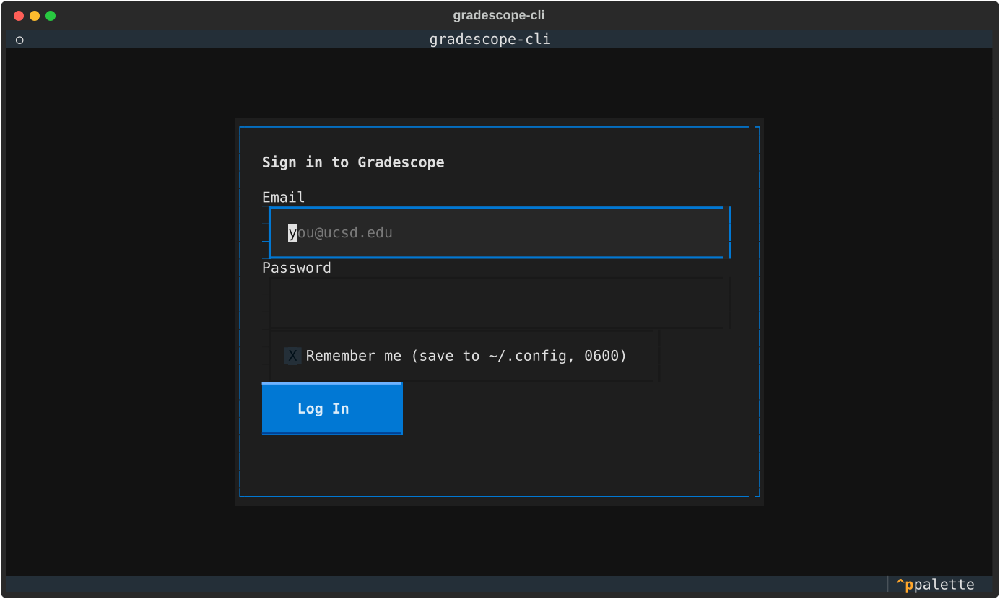
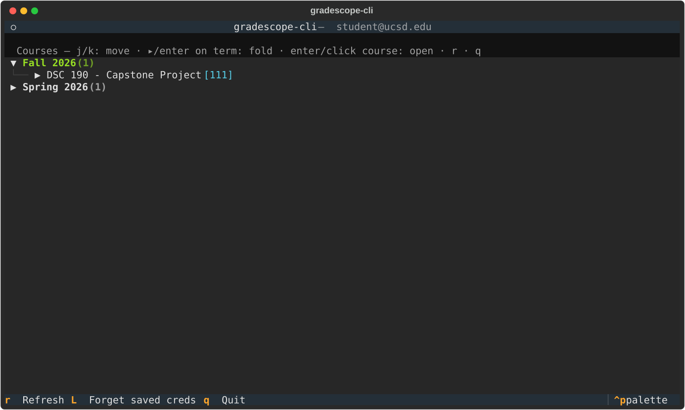
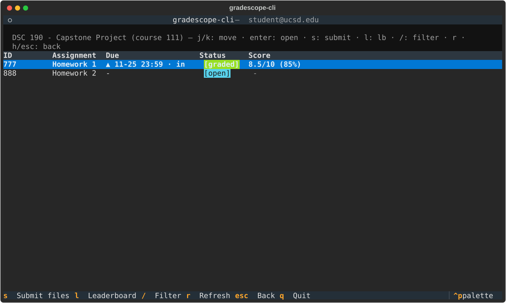
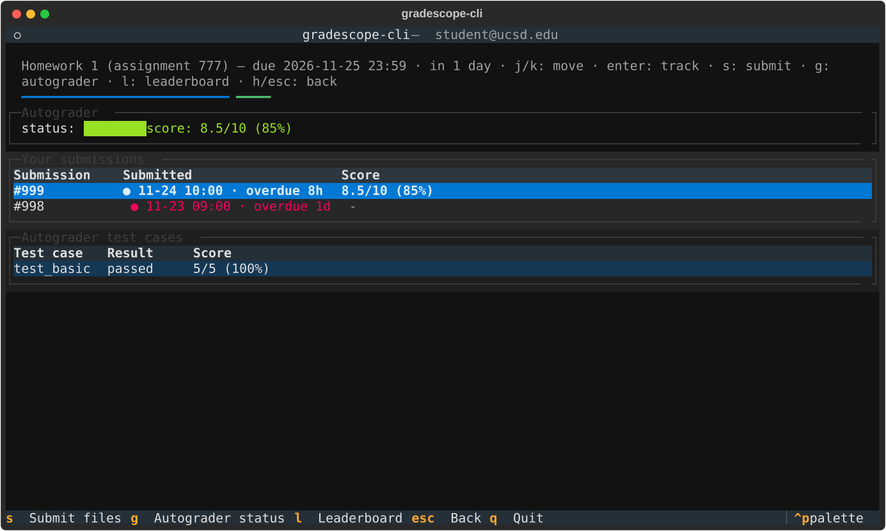
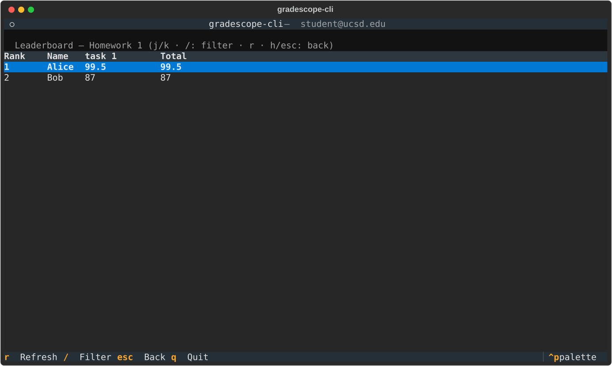
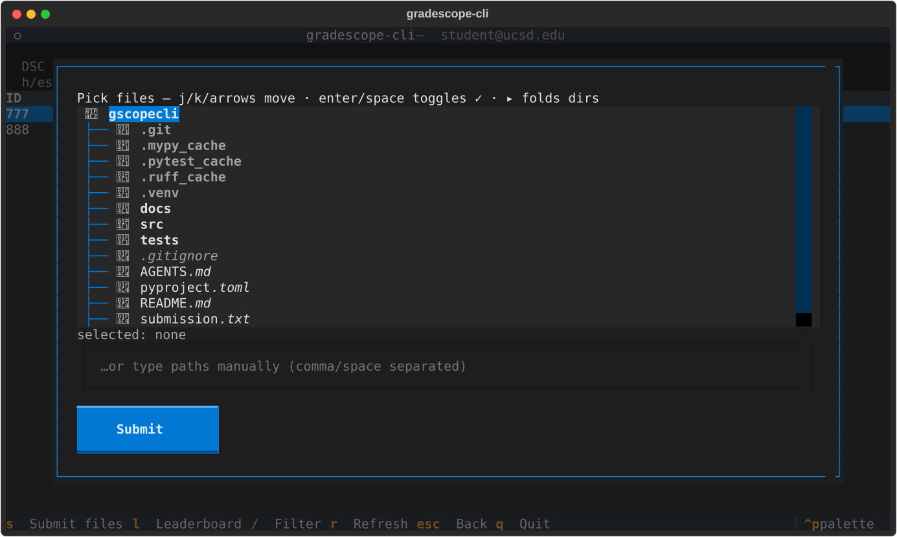

# gradescope-cli

A terminal UI (TUI) for [Gradescope](https://www.gradescope.com), built with
[Python](https://www.python.org/) + [textual](https://textual.textualize.io/).

## The problem

Gradescope's web UI is slow to navigate when you just want to check what's due,
submit a file, or see how the autograder did. gradescope-cli brings the whole
workflow into your terminal: courses, assignments and due dates, one-key file
submission, live autograder progress, submission history, and leaderboards —
with vim keybinds, colors, and filters.

## Features

- **Sign in** with a regular Gradescope account (email + password; SSO not
  supported), with optional credential caching (`~/.config/gradescope-cli/credentials.json`,
  `0600` permissions) or `GRADESCOPE_EMAIL` / `GRADESCOPE_PASSWORD` env vars
- **Courses as a foldable term tree** — current term highlighted, older terms folded
- **Assignments sorted by time-to-due** (soonest on top, most overdue at the bottom),
  with relative due dates (`in 2d`, `overdue 39d`), status chips, and colored scores
- **Submit files with a file picker** (directory tree, multi-select ✓) — submitting
  automatically watches the autograder
- **Autograder tracking**: progress bar + per-test-case results (pass/fail, scores),
  plus your full submission history per assignment
- **Leaderboards**: one column per category plus a total, searchable by name
- **Vim keybinds** (`j`/`k`/`h`) alongside arrow keys and mouse clicks; `/` to filter

## Install

```bash
uv add "git+https://github.com/gsriram67/gscopecli.git"
# then run:
gradescope
```

or from a clone:

```bash
git clone https://github.com/gsriram67/gscopecli.git
cd gscopecli && uv sync && uv run gradescope
```

(`python -m gradescope_cli` works too.)

Set `GRADESCOPE_EMAIL` / `GRADESCOPE_PASSWORD`, or just launch and use the login
screen (tick "Remember me" to cache credentials).

## Usage & screenshots

Launch with `gradescope`. Sign in (or get signed in from env/cache), then:

| Screen | Keys |
| --- | --- |
| Login | type email/password, `enter` / "Log In" · `q` quit |
| Courses (term tree) | `j/k` or arrows move · `enter`/click course opens · `enter`/▸ on a term folds/unfolds · `r` refresh · `L` forget saved creds · `q` quit |
| Assignments | `j/k` move · `enter`/click open · `s` submit · `l` leaderboard · `/` filter by name · `r` refresh · `h`/`esc` back |
| Assignment | `enter` on a submission tracks its autograder · `s` submit · `g` autograder · `l` leaderboard · `h`/`esc` back |
| Leaderboard | `j/k` move · `/` filter by name · `r` refresh · `h`/`esc` back |
| Submit modal (file picker) | `j/k`/arrows move · `enter`/`space`/click toggles a file (✓) · `▸` folds dirs · `Submit` uploads |

### Login screen



### Courses — grouped under foldable terms



### Assignments — due dates, status chips, scores (sorted by time-to-due)



### Assignment detail — autograder results + your submissions



### Leaderboard — per-category columns, searchable



### File picker for submissions



## Repository

Source code: <https://github.com/gsriram67/gscopecli>

## Development

```bash
uv run pytest          # tests (headless TUI tests via textual's Pilot; fake HTTP — no network)
uv run ruff check      # lint
uv run ruff format     # format
uv run mypy            # type check (strict)
```

The backend drives Gradescope's web endpoints (session-cookie login with Rails
CSRF tokens; HTML pages + embedded React JSON props), since Gradescope has no
public REST API. All HTTP is injectable, so tests run fully offline.
